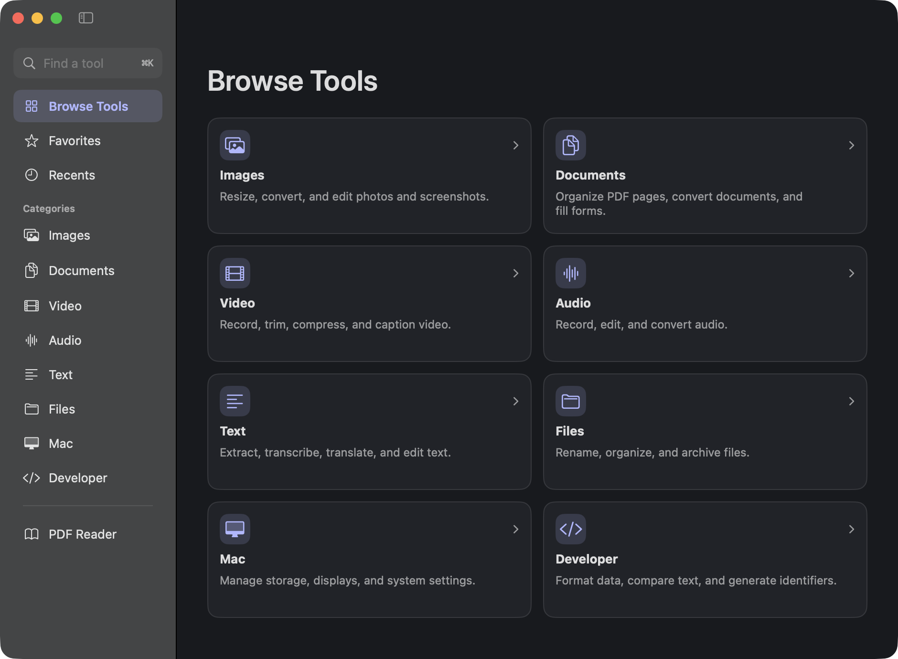

# Mac Utility Kit

Mac Utility Kit brings 105 tools into one native macOS app. Combine or compress PDFs, batch-edit images, convert video and audio, extract text from scans, and handle everyday Mac and developer tasks. File processing runs on your Mac.

**[Download Mac Utility Kit (.dmg)](https://github.com/AdamBlm/mac-utility-kit/releases/download/v0.0.1-preview.2/Mac.Utility.Kit.Preview.2.dmg)** for Apple silicon Macs running macOS 15 or later. [All releases](https://github.com/AdamBlm/mac-utility-kit/releases)



## Find the right tool

Open **Browse Tools** and pick a category, or press **⌘K** to jump to a tool by name. Each category groups tools by task. For example, **Documents → Convert & Compress** includes Compress PDF and Office-to-PDF tools, and **Documents → Pages** includes Merge PDFs and Extract Pages. Star a tool to save it in **Favorites**, or select **Recents** to revisit one you opened.

- **Images and PDFs** — Resize a batch of images, remove backgrounds, pick which pages to keep in a merge, or add searchable text to a scan.
- **Video and audio** — Compress or convert footage, trim clips, extract audio, or transcribe a recording with a local Whisper model.
- **Text, files, and Mac utilities** — Compare text, rename files in batches, inspect disk usage, or find duplicate files.
- **Developer tools** — Format JSON, convert CSV, test regular expressions, and generate or verify hashes.

See the [full tool catalog](docs/feature-inventory.md) or the [tool guide](docs/tool-guide.md) for controls and format support.

## Open files from Finder

In builds that include Finder Services, right-click a PDF or image in Finder and look under **Services** for an action ending in **with Mac Utility Kit**. If you don't see the actions, enable them in **System Settings → Keyboard → Keyboard Shortcuts → Services**.

- **PDFs:** Compress PDF, Organize PDF Pages (one file), and Combine PDFs (two or more).
- **Images:** Compress Images, Resize Images, and Convert Images.

The selected files open in the matching tool, ready for you to review the settings and export.

## Run a local preview

You’ll need an Apple silicon Mac with macOS 15 or later and Xcode 26 or later. From the source checkout, run:

```sh
./scripts/build-app.sh
open "build/Mac Utility Kit.app"
```

This builds an ad hoc signed preview for local use. See [Contributing](CONTRIBUTING.md) for tests and disk-image packaging.

### Opening a preview download for the first time

Preview downloads use an ad hoc signature. macOS may block the first launch because the preview has no Apple Developer ID signature or notarization.

1. If you downloaded the preview from this project's GitHub Releases page and trust the source, drag **Mac Utility Kit.app** into **Applications** and try opening it.
2. If macOS blocks it, open **System Settings → Privacy & Security**, then select **Open Anyway**.
3. Confirm when prompted. macOS saves the exception for this copy of the app. Managed Macs may restrict this option. [Apple's first-launch guidance](https://support.apple.com/en-us/102445)

I’m keeping the preview simple while I see how much interest there is. If enough people find the app useful, I’d like to cover the cost of Apple Developer Program membership so I can offer signed and notarized downloads.

## Optional engines

Many tools work with the frameworks that ship with macOS. If a feature needs an additional engine, open **Settings → Engines** or follow the setup instructions in that tool. Setup panels can provide a Homebrew command or let you select an installed executable.

| For | You may need |
| --- | --- |
| Downloading video from supported sites | yt-dlp, plus FFmpeg for stream merging or conversion |
| WebM export, animated GIFs, or burning in subtitles | FFmpeg with the encoders or filters required by the tool |
| Compressing PDFs | qpdf for structural optimization, Ghostscript for image downsampling, or both |
| Encrypting or decrypting PDFs | qpdf |
| Office document conversion | LibreOffice |
| Transcription | whisper.cpp and a downloaded model |

If managed Video Tools are unavailable in your build, use **Copy Setup Command** in the video setup panel, run the command in Terminal, then choose **Detect Installed Tools** where offered. Managed setup and its optional automatic updates are available in builds configured with a signed engine feed.

## Privacy and network use

File workflows such as image editing, PDF compression, OCR, and transcription run locally once their engines and models are installed. Download Video, Web Page to PDF, Network Speed Test, and map lookups can use the network. App and engine updates, model downloads, and macOS language-pack setup can also connect. Clipboard History is opt-in. Screen and microphone tools ask for their applicable macOS permissions.

The optional `muk` CLI and local MCP server expose a subset of tools. See [Terminal and local MCP](docs/tool-guide.md#terminal-and-local-mcp) for commands and setup.

## Project docs

- [Contributing](CONTRIBUTING.md)
- [Open-source components and reuse research](docs/reuse/README.md)
- [Development plan and tool specifications](docs/plan/README.md)
- [Third-party license notices](licenses/)

## License

Mac Utility Kit's original code and documentation are available under the [MIT License](LICENSE). Third-party components and assets retain their own licenses. See [third-party notices](licenses/) and the [engine release plan](docs/plan/engine-release.md) for bundled and optional tools.
